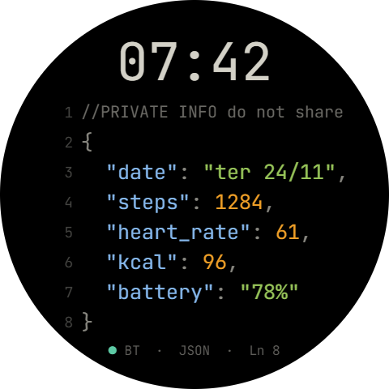

# status.json — mostrador para Amazfit T-Rex 3
[🇺🇸 Read in English](#statusjson--watch-face-for-amazfit-t-rex-3)

Mostrador estilo editor de código (Zepp OS, 480x480): a hora em destaque e os dados do dia em formato JSON, com o comentário e quatro campos editáveis no próprio relógio.



## Estrutura

```
json-face/
├── app.json                         # manifesto (appType: watchface, permissões dos sensores)
├── watchface/index.js               # layout + sensores
└── assets/default.w480-r/
    ├── icon.png                     # preview 324x324 (lista de mostradores)
    ├── edit/                        # imagens do modo de edição (moldura, etiqueta, miniaturas)
    └── fonts/JetBrainsMono-Subset.ttf
```

## Instalar no relógio

1. Node.js 18+ e o Zeus CLI:
   ```bash
   npm i -g @zeppos/zeus-cli
   zeus login
   ```
2. No app Zepp no celular: **Perfil → Configurações → Sobre**, toque 7 vezes no logo do Zepp para liberar o **Modo desenvolvedor**.
3. Na pasta do projeto:
   ```bash
   cd json-face
   zeus preview
   ```
   Escolha o **Amazfit T-Rex 3** quando pedir o dispositivo. Vai aparecer um QR code.
4. No app Zepp: **Perfil → Modo desenvolvedor → Scan**, e escaneie o QR code. O mostrador é instalado e aplicado.

Para testar no simulador antes: `zeus dev` (precisa do Zepp OS Simulator instalado).

## Se o `zeus preview` reclamar do app.json ou dos assets

O formato do `app.json` (v3) e o nome da pasta de assets variam entre versões do Zeus. O jeito mais seguro:

```bash
zeus create teste-wf      # escolha: Watchface → T-Rex 3
```

Compare o `app.json` e a pasta `assets/` gerados com os deste projeto. Copie de lá o bloco `targets` e o nome da pasta de assets, mantenha as `permissions` deste projeto e mova `icon.png` + `fonts/` para a pasta que o template criou. O `appId` gerado pelo template também pode ser usado no lugar do daqui.

## Editar no relógio

Segure o dedo no mostrador, toque em **Editar**, toque na linha e gire a coroa.

- **Comentário (linha 1):** `//PRIVATE INFO do not share`, `//TODO: dormir mais`, `//eslint-disable-line`, `//FIXME: steps < goal`, `//do not commit this file`, `//generated, do not edit` ou `//it works on my wrist`.
- **Linhas 4 a 7:** cada uma mostra um destes dados: `steps`, `heart_rate`, `kcal`, `battery`, `distance`, `spo2`, `stress`, `pai`, `stand` ou `fat_burn`. O padrão é steps, heart_rate, kcal e battery.

A hora e a data ficam fixas.

## Personalizar

Tudo fica no topo de `watchface/index.js`:

- **Cores:** objeto `C` (hex `0xRRGGBB`)
- **Tamanhos:** `TIME_SIZE` (hora), `SIZE` (demais linhas), `LINE_H`, `TOP`
- **Posição horizontal:** `CODE_X`
- **Dias da semana:** array `DAYS`
- **Comentários:** array `COMMENTS` (cada um precisa de uma miniatura `edit/commentN.png`)
- **Dados disponíveis:** objeto `FIELDS`; o padrão das linhas fica em `SLOT_DEFAULTS`

O alinhamento das cores depende da fonte ser monoespaçada (cada caractere = 0,6 × tamanho). Se trocar a fonte, use outra mono ou ajuste `ADV`.

## Comportamento

- Dado sem medição (batimento, SpO2, estresse) aparece como `null` (rosa).
- Bateria aparece como `"78%"`; distância em km com 2 casas; `stand` como horas em pé / meta (`"6/12"`); `fat_burn` em minutos.
- Os dados são relidos a cada minuto e ao acender a tela (o PAI não tem evento de mudança); os outros também atualizam na hora em que o sensor avisa.
- O ● da barra de status fica verde com o celular conectado por Bluetooth e cinza desconectado (atualiza a cada minuto).
- Não tem versão AOD (tela sempre ligada) ainda.

Fonte: JetBrains Mono (SIL OFL 1.1), reduzida aos caracteres usados.

---

# status.json — watch face for Amazfit T-Rex 3
[🇧🇷 Leia em Português](#statusjson--mostrador-para-amazfit-t-rex-3)

Code-editor style watch face (Zepp OS, 480x480): a large time and the day's data as JSON, with the comment and four fields editable right on the watch.


## Structure

```
json-face/
├── app.json                         # manifest (appType: watchface, sensor permissions)
├── watchface/index.js               # layout + sensors
└── assets/default.w480-r/
    ├── icon.png                     # 324x324 preview (watch face list)
    ├── edit/                        # edit mode images (frame, label, thumbnails)
    └── fonts/JetBrainsMono-Subset.ttf
```

## Install on the watch

1. Node.js 18+ and the Zeus CLI:
   ```bash
   npm i -g @zeppos/zeus-cli
   zeus login
   ```
2. In the Zepp app on your phone: **Profile → Settings → About**, tap the Zepp logo 7 times to enable **Developer mode**.
3. In the project folder:
   ```bash
   cd json-face
   zeus preview
   ```
   Pick **Amazfit T-Rex 3** when asked for the device. A QR code will show up.
4. In the Zepp app: **Profile → Developer mode → Scan**, and scan the QR code. The watch face is installed and applied.

To try it in the simulator first: `zeus dev` (requires the Zepp OS Simulator).

## If `zeus preview` complains about app.json or the assets

The `app.json` format (v3) and the assets folder name change between Zeus versions. The safest fix:

```bash
zeus create test-wf      # choose: Watchface → T-Rex 3
```

Compare the generated `app.json` and `assets/` folder with the ones in this project. Copy the `targets` block and the assets folder name from there, keep this project's `permissions`, and move `icon.png` + `fonts/` into the folder the template created.

## Edit on the watch

Long-press the watch face, tap **Edit**, tap a line and turn the crown.

- **Comment (line 1):** `//PRIVATE INFO do not share`, `//TODO: dormir mais`, `//eslint-disable-line`, `//FIXME: steps < goal`, `//do not commit this file`, `//generated, do not edit` or `//it works on my wrist`.
- **Lines 4 to 7:** each one shows one of: `steps`, `heart_rate`, `kcal`, `battery`, `distance`, `spo2`, `stress`, `pai`, `stand` or `fat_burn`. The default is steps, heart_rate, kcal and battery.

Time and date are fixed.

## Customize

Everything is at the top of `watchface/index.js`:

- **Colors:** the `C` object (hex `0xRRGGBB`)
- **Sizes:** `TIME_SIZE` (time), `SIZE` (other lines), `LINE_H`, `TOP`
- **Horizontal position:** `CODE_X`
- **Weekdays:** the `DAYS` array
- **Comments:** the `COMMENTS` array (each one needs an `edit/commentN.png` thumbnail)
- **Available data:** the `FIELDS` object; line defaults live in `SLOT_DEFAULTS`

Color alignment relies on the font being monospaced (each character = 0.6 × size). If you change the font, use another monospaced one or adjust `ADV`.

## Behavior

- Data with no reading (heart rate, SpO2, stress) shows as `null` (pink).
- Battery shows as `"78%"`; distance in km with 2 decimals; `stand` as standing hours / goal (`"6/12"`); `fat_burn` in minutes.
- Data is re-read every minute and when the screen wakes up (PAI has no change event); the others also update as soon as the sensor reports.
- The ● in the status bar is green while the phone is connected over Bluetooth and gray when disconnected (updates every minute).
- No AOD (always-on display) version yet.

Font: JetBrains Mono (SIL OFL 1.1), subset to the characters used.
